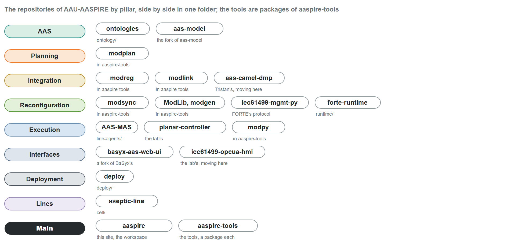

# AASPIRE

**AAS-based Planning, Integration, Reconfiguration and Execution**: plug and produce with the Asset
Administration Shell, for modular production lines whose modules run IEC 61499. Built at the AAU
Smart Production Lab in the AP2030 project.

A module describes itself in its AAS: its skills, the capabilities they realize, its interfaces and
where it stands. From those AASs the line plans new skills, creates them online in the running
IEC 61499 program, connects the modules to the AAS server, and orchestrates production, centrally or
with agents that bid for the steps.

**Documentation:** <https://aaspire.readthedocs.io> (built from `docs/` in this repository).


## The repositories



| Pillar | Repository | What it is |
| --- | --- | --- |
| AAS | [ontologies](https://github.com/AAU-AASPIRE/ontologies) | ARSO, APSO, AProSO and PPRL: the resource, product, process and link ontologies, with the capability and skill vocabulary |
| AAS | [aas-model](https://github.com/AAU-AASPIRE/aas-model) | The lab's AAS model: the types, templates and instances of the product, process and resource AASs |
| Planning | [modplan](https://github.com/AAU-AASPIRE/modplan) | Plans new skills for a module from its Capability Description (HTN; PDDL and HDDL export) |
| Integration | [modreg](https://github.com/AAU-AASPIRE/modreg) | Builds, checks, derives and publishes the AASs; the registration and skill service |
| Integration | [modlink](https://github.com/AAU-AASPIRE/modlink) | Runs a module's skills over its OPC UA server, from its AAS |
| Integration | [aas-camel-dmp](https://github.com/AAU-AASPIRE/aas-camel-dmp) (moving here from Tristan's) | The data-mapping processor: the AASs' Operations call the modules, their values fill the time series |
| Reconfiguration | [modsync](https://github.com/AAU-AASPIRE/modsync) | Keeps a running IEC 61499 program in step with its AAS: reads it back, compares, reconfigures it online |
| Reconfiguration | [iec61499-skill-lib](https://github.com/AAU-AASPIRE/iec61499-skill-lib) | ModLib, the IEC 61499 library for skill-based modules, and modgen, which generates a module's program |
| Reconfiguration | [iec61499-mgmt-py](https://github.com/AAU-AASPIRE/iec61499-mgmt-py) | A Python client for the management protocol of Eclipse 4diac FORTE |
| Reconfiguration | [forte-runtime](https://github.com/AAU-AASPIRE/forte-runtime) | FORTE with ModLib built in, for the PC and the Raspberry Pi; our patches; the Pi installer |
| Execution | [AAS-MAS](https://github.com/AAU-AASPIRE/AAS-MAS) | The multi-agent orchestrator: order, product and resource agents bidding over XMPP (VDI/VDE 2193) |
| Execution | [planar-controller](https://github.com/AAU-AASPIRE/planar-controller) | The planar table's controller: its shuttles as OPC UA modules, multi-shuttle planning |
| Execution | [module-py](https://github.com/AAU-AASPIRE/module-py) | A module run in Python instead of IEC 61499, for devices FORTE does not reach (the robots) |
| Interfaces | [basyx-aas-web-ui](https://github.com/AAU-AASPIRE/basyx-aas-web-ui) (a fork of BaSyx's) | The BaSyx web UI with the skill editor, matching and planning, and the Configurator |
| Deployment | [deploy](https://github.com/AAU-AASPIRE/deploy) | The lab stack (BaSyx, MongoDB, the DMP, InfluxDB, Prosody, the services), the Pi tooling, the bench tools |
| Lines | [aseptic-line](https://github.com/AAU-AASPIRE/aseptic-line) | The lab's aseptic filling line: module specs, generated programs, example AASs, evaluation |

## Working on all of them

The repositories are cloned side by side into one folder, and the Python parts installed editable,
so a change can span several repositories without submodules:

```powershell
mkdir AAU-AASPIRE; cd AAU-AASPIRE
git clone https://github.com/AAU-AASPIRE/aaspire.git
.\aaspire\workspace\clone.ps1 -Install          # every other repository beside it, the Python parts installed
```

(`workspace/clone.sh --install` on Linux and macOS.) Each repository finds the others beside it:
the tools find the ontologies in `../ontologies`, modgen the line's specs in `../aseptic-line/cell`,
the Pi tooling FORTE in `../forte-runtime`.

## This site

```powershell
python -m pip install -r docs/requirements.txt
python -m mkdocs serve           # http://127.0.0.1:8000, rebuilt on every save
python -m mkdocs build --strict  # into site/ (not committed)
```

Read the Docs builds it on every push (`.readthedocs.yaml`). How the pages and figures are made:
[docs/how-to/this-site.md](docs/how-to/this-site.md).

## Licence

MIT, as every AASPIRE repository. Eclipse 4diac FORTE, Eclipse BaSyx and the other components it
builds on keep their own licences.
