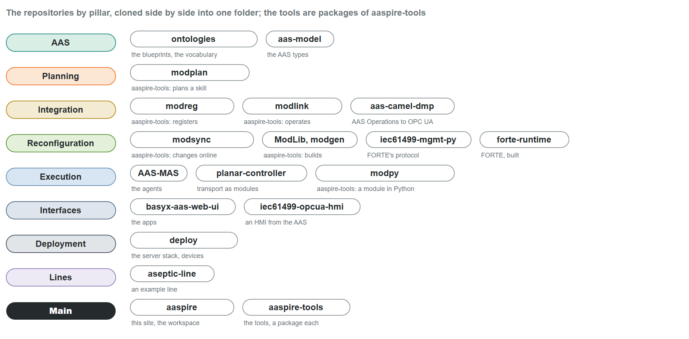

# Repositories

AASPIRE is a set of repositories in the GitHub organization
[AAU-AASPIRE](https://github.com/AAU-AASPIRE), grouped by pillar. The tools that are used together
(ModLib, modgen, modreg, modplan, modsync, modlink, modpy) are one repository,
[aaspire-tools](https://github.com/AAU-AASPIRE/aaspire-tools), with a package per tool.

<figure markdown="span">
  [](../figures/repository-map.png)
  <figcaption>The repositories by pillar, in the pillars' colours, and what each holds.</figcaption>
</figure>

| Pillar | Repository | What it is | Page |
| --- | --- | --- | --- |
| AAS | [ontologies](https://github.com/AAU-AASPIRE/ontologies) | ARSO, APSO, AProSO, PPRL and the vocabulary | [Ontologies](../aas/ontologies.md) |
| AAS | [aas-model](https://github.com/AAU-AASPIRE/aas-model) | The AAS types in Python: product, process, module, component, line | [aas-model](../aas/aas-model.md) |
| Planning | [aaspire-tools](https://github.com/AAU-AASPIRE/aaspire-tools): modplan | Plans a new skill from a module's capabilities | [modplan](../planning/modplan.md) |
| Integration | [aaspire-tools](https://github.com/AAU-AASPIRE/aaspire-tools): modreg | Builds, checks, derives and publishes the AASs; the registration service | [Registration service](../integration/registration.md) |
| Integration | [aaspire-tools](https://github.com/AAU-AASPIRE/aaspire-tools): modlink | Runs a module's skills over OPC UA from its AAS | [modlink](../integration/modlink.md) |
| Integration | [aas-camel-dmp](https://github.com/AAU-AASPIRE/aas-camel-dmp) | The data-mapping processor | [DMP](../integration/dmp.md) |
| Reconfiguration | [aaspire-tools](https://github.com/AAU-AASPIRE/aaspire-tools): modsync | Keeps a running IEC 61499 program in step with its AAS | [modsync](../reconfiguration/modsync.md) |
| Reconfiguration | [aaspire-tools](https://github.com/AAU-AASPIRE/aaspire-tools): ModLib, modgen | The IEC 61499 library for skill-based modules, and its generator | [Skill library](../reconfiguration/skill-lib.md) |
| Reconfiguration | [iec61499-mgmt-py](https://github.com/AAU-AASPIRE/iec61499-mgmt-py) | The client of FORTE's management protocol | [Management library](../reconfiguration/mgmt.md) |
| Reconfiguration | [forte-runtime](https://github.com/AAU-AASPIRE/forte-runtime) | FORTE built for the PC and for edge devices, its patches, the device installer | [FORTE runtime](../reconfiguration/runtime.md) |
| Execution | [AAS-MAS](https://github.com/AAU-AASPIRE/AAS-MAS) | The multi-agent orchestrator (package `lineagents`) | [Line agents](../execution/agents.md) |
| Execution | [planar-controller](https://github.com/AAU-AASPIRE/planar-controller) | A planar motor table offered as modules | [Planar controller](../execution/planar-controller.md) |
| Execution | [aaspire-tools](https://github.com/AAU-AASPIRE/aaspire-tools): modpy | A module written in Python, for controllers that do not run IEC 61499 (robots) | |
| Interfaces | [basyx-aas-web-ui](https://github.com/AAU-AASPIRE/basyx-aas-web-ui) | The BaSyx web UI with AASPIRE's apps: the Planner, the Skill Editor, the Configurator | [Web UI](../interfaces/web-ui.md) |
| Interfaces | [iec61499-opcua-hmi](https://github.com/AAU-AASPIRE/iec61499-opcua-hmi) | An HMI for any module, built from its AAS, with a module simulator | |
| Deployment | [deploy](https://github.com/AAU-AASPIRE/deploy) | The server stack, the edge device tooling, bench tools | [Deployment](../deployment/deploy.md) |
| Lines | [aseptic-line](https://github.com/AAU-AASPIRE/aseptic-line) | An example line: specs, generated programs, AASs, simulators, evaluation | [A line's repository](../lines/aseptic-line.md) |
| Main | [aaspire](https://github.com/AAU-AASPIRE/aaspire) | This site, the repositories' map, the workspace scripts | [This site](../how-to/this-site.md) |

## Get them all

Clone every repository side by side into one folder; the workspace script does it and installs the
Python parts editable:

```powershell
mkdir AAU-AASPIRE; cd AAU-AASPIRE
git clone https://github.com/AAU-AASPIRE/aaspire.git
aaspire\workspace\clone.ps1 -Install          # or aaspire/workspace/clone.sh on Linux
```

## How they come together

- **Side by side, no submodules.** Each repository finds the others beside it: the tools find the
  ontologies, modgen a line's specs (in `aseptic-line/cell`, `./cell`, or `$MODGEN_CELL`), the device
  tooling FORTE, the server stack the DMP and the web UI for its images.
- **Dependencies by repository.** Each Python part declares the others it needs as Git dependencies
  of the organization's repositories; the server stack's images are built from the folder that holds
  them.
- **Versions**: the parts by SemVer, `aaspire` by date (`2026.11`, `2027.01`, ...).

Pinned, from outside: Eclipse 4diac FORTE, the BaSyx images, unified-planning, the IDTA templates.

The reference documents behind the pages (the models, the module rules, the tools) are this site's
[Reference](../reference/aas-models.md) section.
